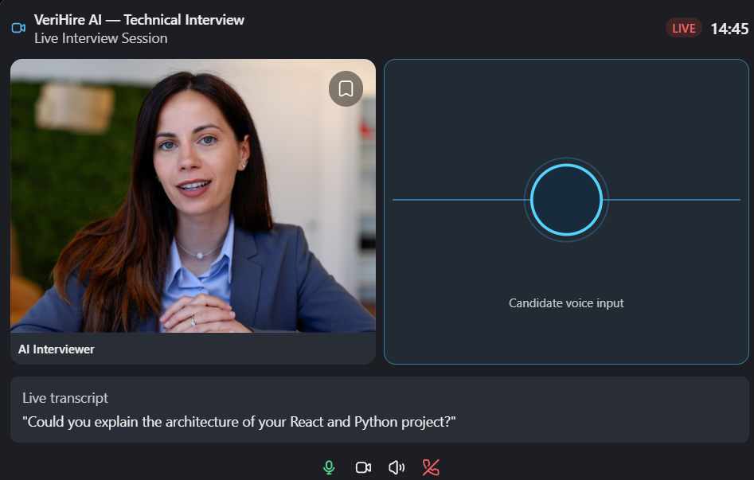

# VeriHire AI

**Intelligent Resume Verification, AI Interview, Skill Assessment and Job Application Platform.**

A student project with three roles — **Candidate**, **Recruiter**, **Administrator** — and a fully
**local** AI/ML pipeline. **No paid AI API keys are required or used**: all resume parsing,
skill extraction, similarity scoring and interview evaluation run on this machine.

---

## Stack

| Layer     | Technology |
|-----------|------------|
| Frontend  | React 18, TypeScript, Vite, Tailwind CSS, React Router, Recharts, Axios |
| Backend   | Node.js, Express, TypeScript, MongoDB, Mongoose, JWT (httpOnly cookie), bcryptjs |
| AI engine | Python, FastAPI, scikit-learn, pdfplumber, python-docx (all local, deterministic) |
| Deploy    | Dockerfiles + Docker Compose (optional), health checks, `.env` config |

## Repository layout

```
verihire-ai/
  frontend/      React SPA (Vite dev server, port 5173)
  backend/       Express API (port 4000)
  ai-engine/     Local Python NLP service (port 8000)      [Phase 3]
  infrastructure/ deployment configs                        [Phase 9]
  scripts/       helper scripts
  docs/          documentation                              [later phases]
  docker-compose.yml
  .env.example
```

## Prerequisites

- **Node.js ≥ 20** (tested with Node 24)
- **Python 3.11+** (needed from Phase 3 for the AI engine)
- **Git**
- MongoDB is **optional** for local development: if no server answers at `MONGODB_URI`, the
  backend automatically starts a **local in-memory MongoDB** (mongodb-memory-server). Data then
  lives only until the backend stops — perfect for demos, not for persistence.
- Docker is **optional**. See "Running with Docker" (Phase 9).

## Quick start (Windows PowerShell, no Docker)

```powershell
# 1. Install dependencies (first time only)
npm --prefix backend install
npm --prefix frontend install

# 2. Python AI engine (first time only)
cd ai-engine
python -m venv .venv
.\.venv\Scripts\python.exe -m pip install -r requirements.txt
cd ..

# 3. Environment (optional — defaults work for development)
Copy-Item .env.example .env

# 4. Start the local AI engine (Terminal 1) — http://127.0.0.1:8000
cd ai-engine
.\.venv\Scripts\python.exe -m uvicorn app.main:app --host 127.0.0.1 --port 8000

# 5. Start the API (Terminal 2) — port 4000
npm --prefix backend run dev

# 6. Start the web app (Terminal 3) — port 5173
npm --prefix frontend run dev

# 7. (Optional) create the administrator account (Terminal 4)
npm --prefix backend run seed:admin
```

Open **http://localhost:5173** in your browser.

- The Vite dev server proxies `/api/*` to `http://localhost:4000`.
- Sessions are httpOnly cookies; nothing sensitive is stored in browser storage.

### Health check

```powershell
Invoke-RestMethod http://localhost:4000/api/health
```

## Tests

```powershell
npm --prefix backend test      # Vitest + supertest (uses local MongoDB or in-memory fallback)
npm --prefix frontend test     # Vitest + Testing Library
cd ai-engine; .\.venv\Scripts\python.exe -m pytest   # engine tests
```

Backend tests include a live end-to-end suite (`resume.live.test.ts`) that uploads real
sample PDF/DOCX files through the Python engine. It is skipped automatically when the AI
engine is not running. Sample resumes are in `docs/samples/` (synthetic data only, generated by
`ai-engine/scripts/make_fixtures.py`).

The job tests (`backend/src/tests/jobs.test.ts`, `ai-engine/tests/test_job_links.py`,
`frontend/src/test/jobs.test.tsx`) mock only the local engine and the public board
fetches; authentication, MongoDB and the route logic are real. The configured
job boards can be checked against their live public APIs with
`python scripts/verify_job_sources.py` (development diagnostic; prints real posting
counts and never writes to the database).

## Security notes

- Passwords are hashed with bcrypt (cost 10).
- JWT is delivered as an **httpOnly, SameSite=Lax cookie**; server-side role checks guard every
  protected route (`candidate` / `recruiter` / `admin`).
- Rate limiting on auth endpoints; Helmet security headers; CORS restricted to the frontend origin.
- The admin account can only be created by the seed script, never by self-registration.
- Resume extraction uses a separate, time-limited local parser process with upload,
  PDF page, text and DOCX archive expansion limits. This process runs under the
  same user account and is not an operating-system sandbox or antivirus scan.
  Uploaded originals are kept in the configured private directory; on Windows,
  filesystem access also depends on the directory's Windows ACLs.

## Project status

### Local voice interview extension

The interview setup includes a live voice mode with local Whisper/Piper speech,
an illustrated interviewer, optional camera preview and face-presence events,
saved transcripts, and the original text-mode fallback. See
[voice installation, verification and limitations](docs/LIVE_INTERVIEW.md).
The HTTP/WebSocket/speech/report pipeline has been verified using synthetic audio.
A user reported that a spoken greeting appeared in the transcript and received
a spoken reply. A complete human interview and broader device checks remain open.

### Domain, device-check and job-matching checkpoint (in progress)

Resume review now offers local domain suggestions and candidate confirmation, and
the live interview includes microphone-level, audio-playback and connection checks.
The expanded versioned domain bank gives every domain substantive
beginner/intermediate/advanced questions, and mixed-domain interviews keep coverage
when the requested count truncates the pool. Candidates also get a **Job matches**
page backed by real vacancies from public company job boards, along with saved jobs
and application tracking — see below and [docs/PHASE5.md](docs/PHASE5.md).
These changes remain a development checkpoint: the resume → domains → interview →
report workflow still needs a full human end-to-end pass, and job-board
availability varies with the network.

### Job matching and application tracking (Phase 5)

After resume review, candidates see **role directions** (curated role ideas matched
to skills mentioned in the selected resume — not advertised vacancies), and a
**Job matches** page that lists real vacancies read from public company job boards.

- Sources are configurable real boards using the documented public Greenhouse and
  Lever APIs (`backend/src/config/jobSources.json`); verify them any time with
  `python scripts/verify_job_sources.py`. No vacancy is ever invented, and a
  board that fails keeps its previously stored postings and shows an error state.
- Matching uses required-skill coverage, project/experience evidence, text relevance
  and your own stated preferences, with visible weights. Interview scores are excluded
  until answer authorship is recorded; missing parts are reweighted and shown.
  The percentage is a relevance estimate, **not** a probability of hiring.
- Application links are labelled honestly: `Apply Now` only when the provider
  documents a posting-specific application form, otherwise `View Job` or
  `Search Openings`. Nothing is ever auto-submitted.
- Saved jobs and applications are candidate-controlled; opening a link never marks
  anything as applied. An application is recorded only after you explicitly confirm
  it, and every status change is kept as history.
- Discovery is the *only* feature that uses the internet (plus explicitly approved
  downloads). Requests are anonymous reads of public boards, serialized with a
  pause, and candidate data is never sent to a provider.

See [docs/PHASE5.md](docs/PHASE5.md) for the API contract, matching model, link
rules, test evidence and current limitations.

### Voice interview design reference

The supplied design reference for the live interview experience:



- [x] Phase 1 — inspection & tooling
- [x] Phase 2 — foundation: monorepo, Express+TS API, auth (register/login/session/logout),
      profile management, role-based authorization, in-memory MongoDB fallback, React shell
- [x] Phase 3 — resume upload (PDF/DOCX), local extraction (skills, education, projects,
      experience), claim-level findings, editable review, private storage, MongoDB persistence,
      sidebar + dashboard integration
- [x] Phase 4 — personalized AI interview engine: local curated questions, adaptive follow-ups,
      difficulty levels, rubric scoring, MongoDB session resume and detailed results.
      See [Phase 4 implementation and verification](docs/PHASE4.md).
- [ ] Phase 5 — skills dashboard & job matching: explainable matching over real
      public vacancies, honest application links, saved jobs. See [docs/PHASE5.md](docs/PHASE5.md).
- [ ] Phase 6 — application tracking: candidate-confirmed statuses with history;
      opening a link never marks a job applied. See [docs/PHASE5.md](docs/PHASE5.md).
- [ ] Phase 7 — recruiter & admin dashboards
- [ ] Phase 8 — security hardening & full workflow tests
- [ ] Phase 9 — Docker & deployment docs
